# Vision

A fast, native home launcher for rooted LG webOS TVs (developed on an LG CX, webOS 5).
Rust + SDL2 + a custom OpenGL ES 2 renderer, around 3 MB, no web view.

> **🍺 Homebrew app store built in.** Browse every app of the webOS Homebrew repository right from
> your home screen, and install, update or uninstall it with one click. No PC, no Dev Manager.
> [See how it works ↓](#homebrew-app-store)

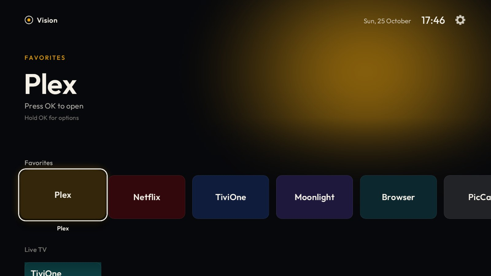

| | |
|---|---|
| 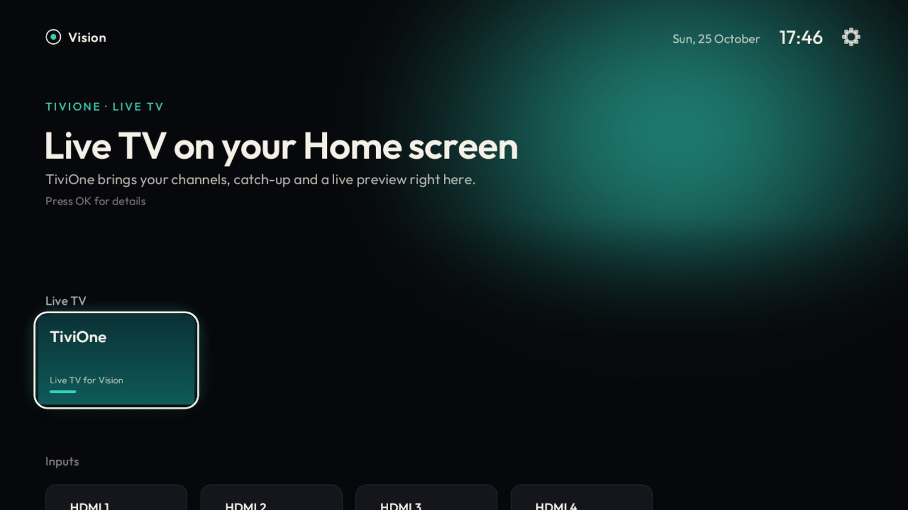 | 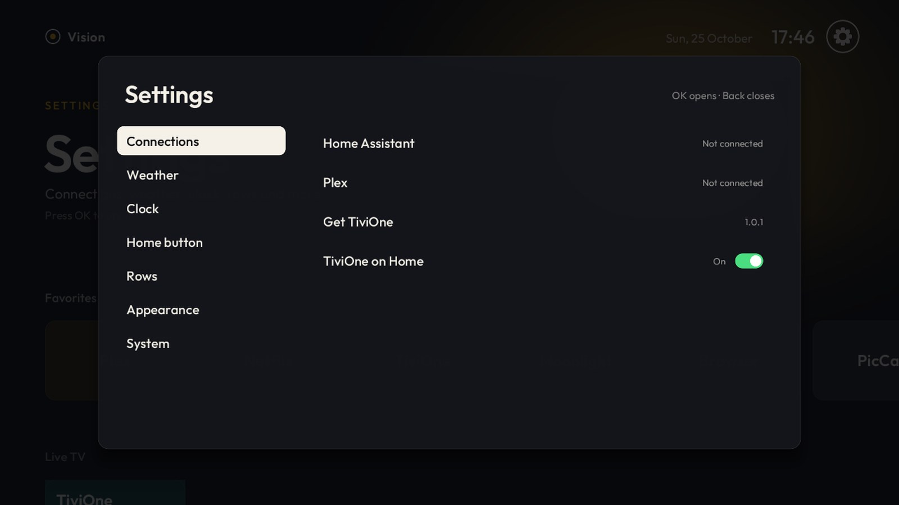 |

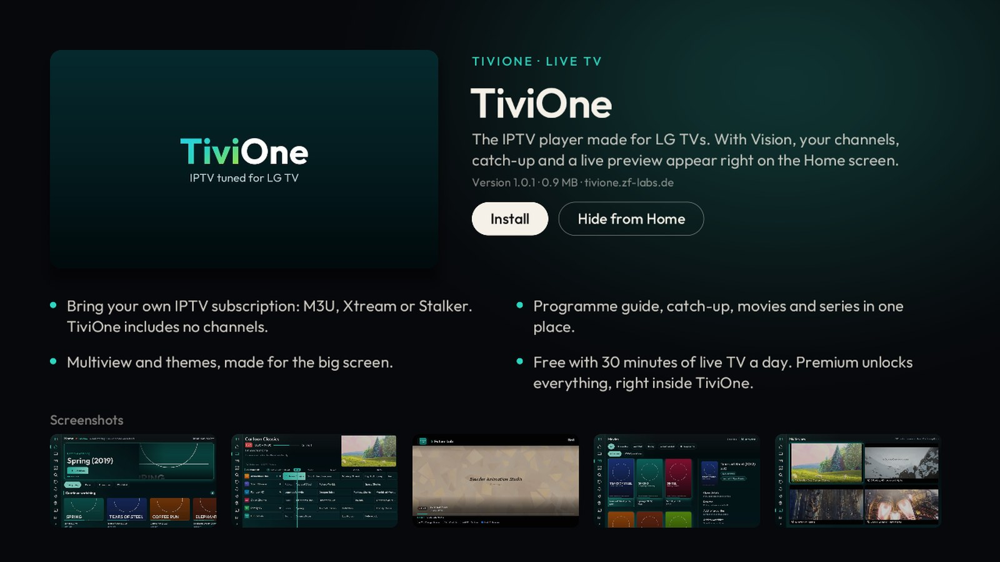

## Features

- **Homebrew app store:** all apps of the webOS Homebrew repository with icons, details and updates; install and uninstall them on the TV ([see below](#homebrew-app-store)).
- **Your apps, your order:** LG's apps with full-tile artwork, favourites you can move and hide, HDMI inputs with signal state.
- **Vision as Home:** the Home key opens Vision instead of LG's launcher, in about 50 ms (see below).
- **Ambient light** taken from the focused tile, a large hero with what is focused, clock and weather.
- **Home Assistant:** lights, switches and scenes as tiles, chosen by category and room. Set up from the phone via QR code.
- **Plex:** continue watching, linked through plex.tv/link.
- **TiviOne (optional):** with the TiviOne IPTV app installed and connected, Vision shows recent and favourite channels, catch-up, upcoming reminders and a muted live preview of the focused channel; the number keys tune channels.
- **Six languages:** English, German, French, Spanish, Italian, Turkish (follows the TV, can be changed).
- **Magic Remote:** point to focus, click to open, hold for options, wheel to step along a row.
- **Two looks:** Cinematic and Glass (see below), switchable in Settings while Vision runs.

## Homebrew app store

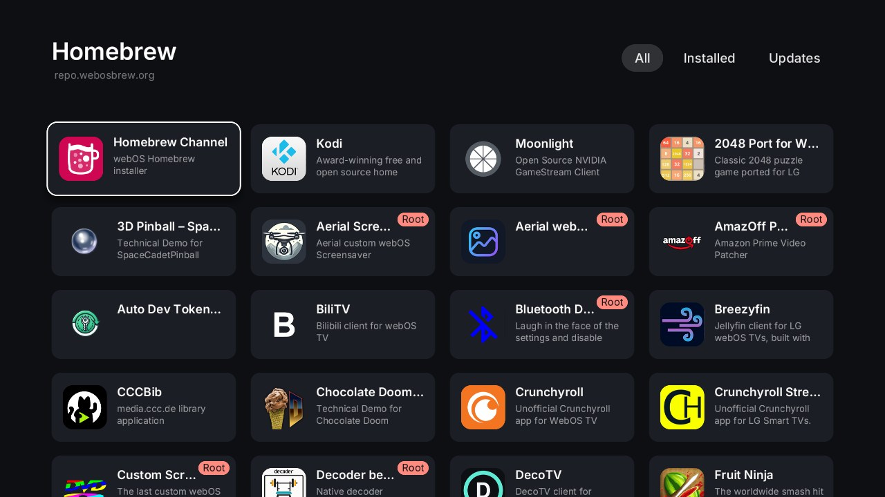

Open the **Homebrew** tile among your apps and you get the whole
[webOS Homebrew repository](https://repo.webosbrew.org) on your TV:

- **Browse** every app with its icon and description, in three tabs: **All**, **Installed** and **Updates**.
- **Install** with one click; **Update** shows up as soon as the repository has a newer version.
- **Open** or **Uninstall** installed apps from the same page (uninstalling asks first).
- **Safe:** Vision checks each package's SHA-256 against the repository before installing it through
  Homebrew Channel. Apps that run with root rights are marked *Root*; before installing or updating
  one, Vision shows a warning and asks twice. Vision and Homebrew Channel themselves cannot be
  uninstalled here.
- **Extras:** [own-your-glass](https://github.com/JulioFerrero/own-your-glass) (hardens the TV: microphones,
  screen capture, ads, telemetry) is listed too, installed from its GitHub releases. It needs webOS 10
  or newer; on older TVs it shows greyed out with a note and cannot be installed.
- The tile behaves like any app: move it or hide it with **Hold OK**.

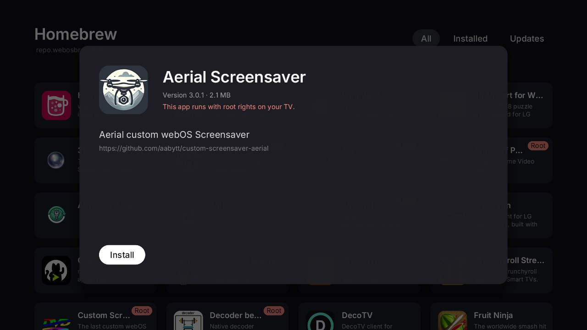

## Themes

A theme changes the whole home screen: layout, navigation, typography, focus effects and the
settings screens, not just colours. Switch it in **Settings → Appearance → Theme**.

**Cinematic:** a large title over ambient light from the focused tile, with rows of apps, channels,
Home Assistant tiles and inputs.

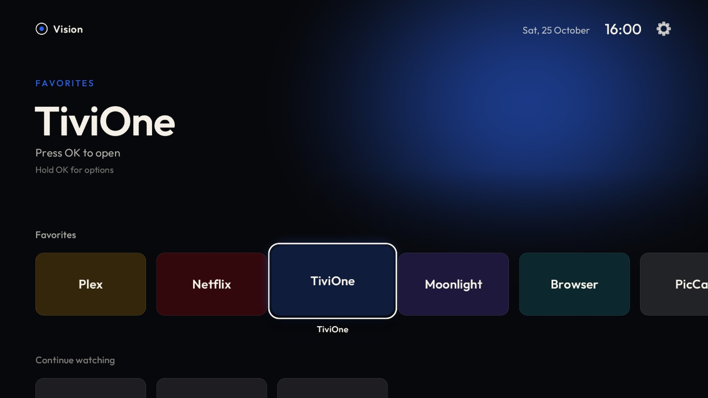

**Glass:** a photo wallpaper with the first row of apps in a frosted dock and more rows below it,
the gear for Settings at the top left and a large clock at the top right. Focus enlarges a tile with
a white frame, a soft sheen and a slight parallax tilt; apps wiggle while you move them. When TiviOne
or Plex has focus in the dock, its channels or "continue watching" appear above the dock, and Up
opens them with programme details and the live preview. Three wallpapers come with Vision, or send
your own photo from your phone (**Settings → Appearance → Photo from your phone**). Glass uses the
Inter typeface.

| | |
|---|---|
| 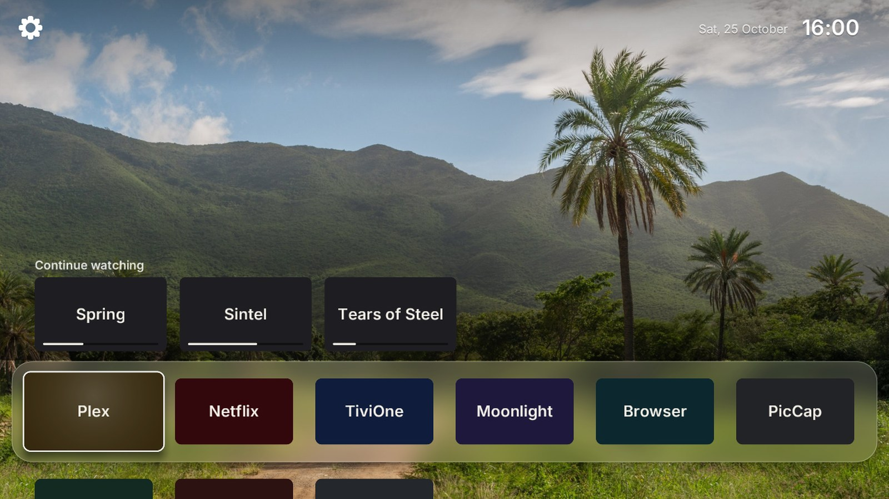 | 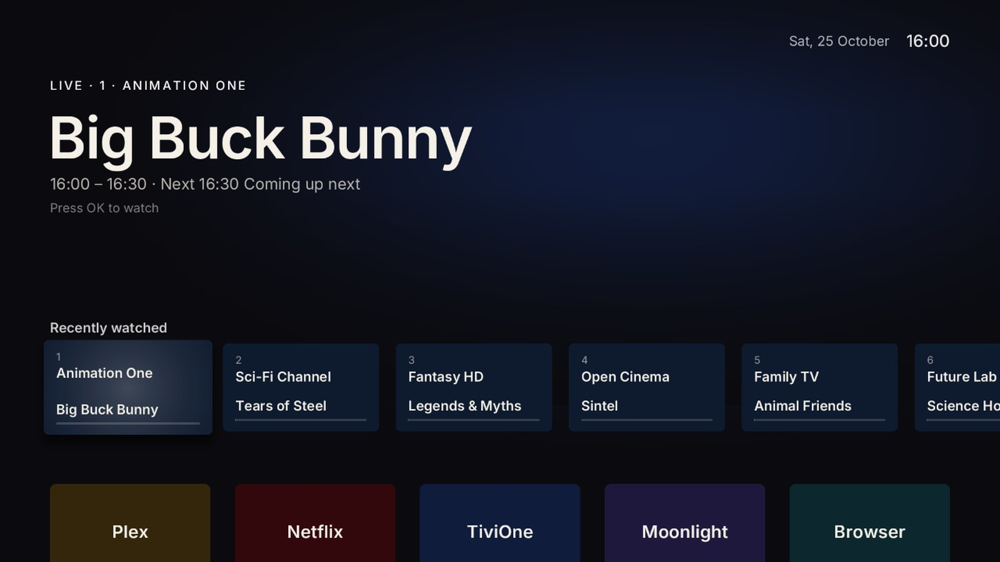 |
| 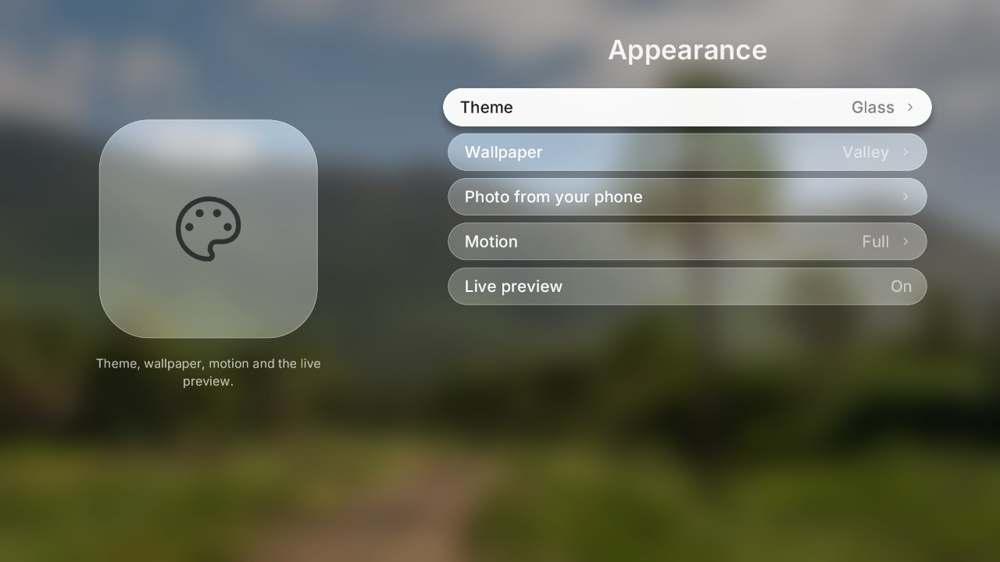 | 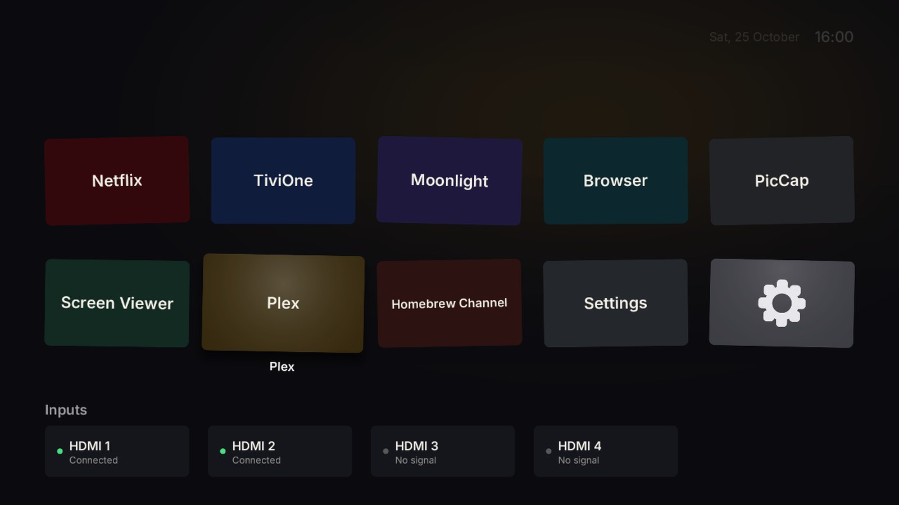 |

## Performance

Performance comes first. Measured on the CX (Mali-G51):

| Metric | Value |
|---|---|
| Cold start to first frame | ~250 ms (~430 ms on the first start after an update) |
| Home key to Vision (already running) | ~50 ms |
| CPU work per frame while navigating | ~1 ms (max ~4 ms) |
| Frame rate | 50 fps (the TV's UI refresh), steady |
| GPU when idle | 0 % (draws only when something changes) |
| Draw calls per frame | 1–3 |

How it stays fast:

- **Render on demand:** the UI thread sleeps until a key, new data, the next minute or a running animation wakes it.
- **One shader for everything:** rounded rects, soft shadows, glows and strokes are analytic SDFs. No offscreen passes, no real-time blur.
- **Batched drawing** from texture atlases. Glyphs are rasterised once on a background thread; the packed atlas is kept on disk and read back on later starts.
- **Nothing blocks the UI thread:** Luna calls, network requests, file access and image decoding run on workers.
- **Nothing is linked at build time:** SDL, GLES, libluna-service2 and GLib are loaded with `dlopen`.

## Installing

Vision needs a **rooted** LG webOS TV with [Homebrew Channel](https://github.com/webosbrew/webos-homebrew-channel)
(root is used for the app list and artwork, switching the Home key and installing apps).

1. Download the `.ipk` from the [latest release](https://github.com/fatgue/lg-vision-launcher/releases).
2. Install it with Homebrew Channel or the webOS Dev Manager.
3. Open Vision. To make it your Home launcher: **Settings → Home button → Vision as Home**.

## TiviOne

[TiviOne](https://tivione.zf-labs.de) is an IPTV player for LG TVs by the same developer. It brings its own
features; Vision only shows what TiviOne shares with it, and only after you agree.

- Without TiviOne, Vision shows one TiviOne tile under *Live TV*. **OK** opens its page with pictures and details
  and an **Install** button; **Hide from Home** (or holding OK on the tile) removes the tile for good.
  **Settings → Connections** always keeps a *TiviOne* entry, and *TiviOne on Home* brings the tile back.
- **Install** downloads TiviOne from tivione.zf-labs.de. Vision checks the release manifest's Ed25519
  signature and the package's SHA-256 before installing it through Homebrew Channel. For a TiviOne installed
  this way, Vision offers updates the same way; a TiviOne from the LG Content Store updates through LG.
- TiviOne includes no channels: it plays your own IPTV subscription. It is free with 30 minutes of live TV a
  day; Premium is bought inside TiviOne.
- Connecting is opt-in: TiviOne opens once to pair, then shares an encrypted snapshot (channels, recent,
  favourites, guide, catch-up) through a local file. **Settings → Connections → TiviOne** turns it off again.

## Using it

- **Left / Right / Up / Down** move the focus; **OK** opens the app, input or channel.
- **Homebrew:** open the Homebrew tile; **Left / Right** at the top switch between All, Installed and Updates, **OK** opens an app's page.
- **Hold OK** on a favourite: **Move** (Left / Right, OK to finish, Back to cancel) or **Hide**.
  Hidden apps have their own row at the bottom; hold OK there to show them again.
- **Settings:** press **Up** from the top row (or click the gear); in Glass the gear sits at the top left.
  - Connections: Home Assistant, Home tiles, Plex, TiviOne
  - Weather: show or hide, location (from Home Assistant or a city entered on the phone), °C / °F
  - Clock: 24- or 12-hour, date
  - Home button: Vision as Home on or off
  - Rows: show or hide each row
  - Appearance: theme, wallpaper and a photo from your phone (Glass), ambient light (Cinematic), motion, live preview
  - System: language, reload app images, version

## Vision as Home

On webOS 5 and 6, Vision can take over the Home key:

```sh
sh /media/developer/apps/usr/palm/applications/com.vision.launcher/home.sh enable
sh /var/lib/vision-home/home.sh disable   # back to LG's Home
```

`tv/home.sh` bind-mounts Vision's executable over `/usr/bin/com.webos.app.home`. LG's Home manifest and LS2
role stay untouched and nothing on the read-only system partition changes. Vision registers itself with the
application manager, so the Home key brings the running instance to the front. A Homebrew Channel boot hook
(`64-vision-home`, a symlink) re-applies the mount after a cold boot and does nothing if Vision is gone.

## Network and privacy

Vision talks only to what you set up, plus two public services:

| Service | When | What |
|---|---|---|
| open-meteo.com | weather is on | the location's coordinates |
| Your Home Assistant | connected | states and your actions (LAN) |
| plex.tv / your Plex server | connected | continue watching, artwork |
| tivione.zf-labs.de | at most every 6 hours | the signed TiviOne release manifest (no data is sent) |
| repo.webosbrew.org | the Homebrew page is opened | the app list, icons and the packages you install (no data is sent) |
| github.com | the Homebrew page is opened | the release manifest of the extras (own-your-glass) and their packages |

Settings and tokens stay on the TV in `/media/developer/vision`. There is no analytics or telemetry.

## Development

Requirements: Rust (MSVC host), target `armv7-unknown-linux-gnueabi`, [Zig](https://ziglang.org) 0.14 and
`cargo-zigbuild`, Node.js, PuTTY (`plink` / `pscp`).

```sh
sh scripts/fetch-deps.sh        # fetch the SDL libraries (once)
node scripts/make-icons.mjs     # generate the app icons (once)

cargo run                       # desktop preview with sample data
cargo run -- --frames 120 --keys down,ok --screenshot shot.png
                                # (`wait` in --keys skips a step; VISION_WEBOS=10 plays a webOS 10 TV)

node scripts/package.mjs        # TV build (ARMv7 softfp, glibc 2.28) + IPK in out/
node scripts/tv.mjs install     # upload to the TV and install
node scripts/tv.mjs launch      # start it
node scripts/tv.mjs bench       # scripted navigation, frame timings in the log
node scripts/tv.mjs log         # show the log
node scripts/tv.mjs shot        # capture the UI plane to out/tv.jpg
```

Set the TV with `VISION_TV_HOST` and `VISION_TV_PASSWORD`.

**Releases:** bump the version in `Cargo.toml` and `appinfo.json`, then push a tag `vX.Y.Z`. GitHub Actions
(`.github/workflows/build.yml`) builds the package from that tag and attaches it, with `SHA256SUMS`, to the release.
Every push to `main` builds it too (download it from the workflow run).

```
src/main.rs       event loop, window and GL context, frame timing
src/render.rs     GLES2 batch renderer (SDF shader)
src/text.rs       glyph atlas (fontdue)
src/home/         home screen: state and focus (mod.rs), the Cinematic and Glass looks,
                  navigation, settings and pages (TiviOne, Homebrew)
src/theme.rs      design tokens
src/platform.rs   TV services worker (desktop: sample data)
src/services.rs   weather, Home Assistant, Plex, TiviOne snapshot
src/installer.rs  TiviOne release check; download, verification, install and uninstall of apps
src/video.rs      live preview on the TV's video plane
src/luna.rs       Luna client (libluna-service2 + GLib)
src/strings.rs    all user-visible text, six languages
```

## Licence

Vision is released under the [MIT licence](LICENSE). Not affiliated with LG Electronics.

- SDL2 / SDL-webOS: zlib licence (`licenses/SDL2.txt` in the IPK)
- Outfit (typeface): SIL Open Font License 1.1 (`assets/fonts/OFL.txt`)
- Inter (typeface, Glass): SIL Open Font License 1.1 (`assets/fonts/Inter-OFL.txt`), subset to Latin
- Wallpapers: CC0 photos from Wikimedia Commons (`assets/wallpapers/CREDITS.txt`)
- The Home takeover follows the approach of [Luma](https://github.com/ecklf/lg-luma) (MIT); no code was copied.
